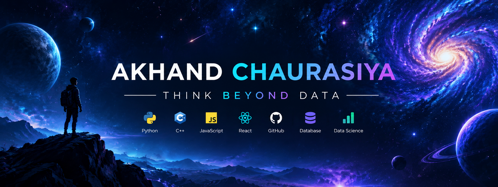

 

# Hi, I'm Akhand Chaurasiya

### Aspiring Data Analyst | Python | SQL | Power BI | AI

*Turning complex data into clear decisions and ambitious ideas into meaningful solutions.*

---

## 🌌 THE VISION

I am passionate about exploring the intersection of **business intelligence, data science, artificial intelligence, and the mysteries of the universe**.

My goal is to transform raw information into meaningful insights, build useful applications, and communicate complex ideas through technology and visualization.

I believe curiosity drives innovation—and data helps turn curiosity into discovery.

## 🎯 AREAS OF FOCUS

- 📊 **Business Analytics** — understanding performance and supporting decisions.
- 🧠 **Data Science** — discovering patterns and extracting insights.
- 🤖 **Artificial Intelligence** — exploring intelligent, practical solutions.
- 🌌 **Science & Space** — using data and technology to explore big questions.
- 💻 **Software Development** — building applications that solve real problems.

## 🛠️ TECHNOLOGY TOOLKIT

Tools I currently use or am actively learning.

## 🚀 PROJECTS WITH PURPOSE

<!-- PROJECTS-START -->
_Project information will be updated automatically by GitHub Actions._

<!-- PROJECTS-END -->

## 📈 GITHUB ACTIVITY

## 🌠 BEYOND THE HORIZON

*“Explore the unknown. Understand the data. Build what comes next.”*

